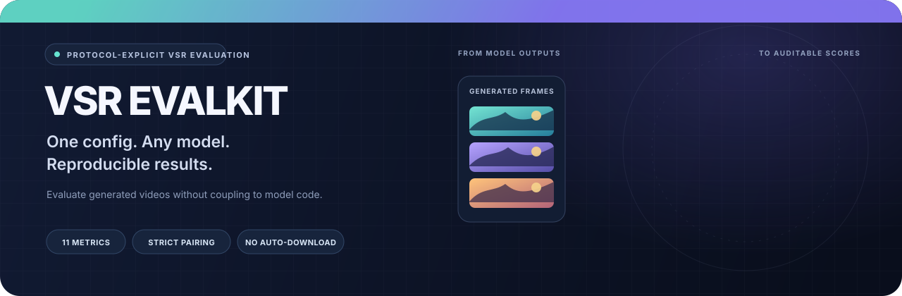

<div align="center">



[](README.md) [](README_EN.md)

   [](LICENSE)

**独立评价已经生成的视频超分结果。** 模型代码不再和指标脚本绑在一起：路径配置一次，按模型和数据集运行。

[快速开始](#快速开始) · [指标与协议](#指标与协议) · [完整文档](#文档) · [验证状态](#验证状态)

</div>

```bash
vsr-eval run --config eval.local.yaml --model dove --dataset udm10
vsr-eval run --config eval.local.yaml --model dove,seedvr2 --dataset udm10,videolq
```

`vsr-evalkit` 只评价你已经生成的视频，不负责 VSR 推理。支持 PNG/JPEG 帧序列和 MP4、MKV、MOV、AVI；预测与 GT 可以使用不同存储格式，也可以通过映射文件处理命名差异。

## 为什么做这个工具

| 结果路径和数据集分开配置 | 显式评价协议 | 可追溯输出 |
|---|---|---|
| 新模型通常只需注册结果目录；不必把评价代码复制进每个模型仓库。 | 不自动裁齐、缩放或截短。颜色空间、采样、聚合和光流设置都会写入协议标识。 | 输出逐帧/帧对、逐视频和数据集结果，并记录权重哈希、依赖版本、采样索引和失败原因。 |

支持跨视频的不同分辨率和长宽比；同一条序列内部尺寸必须固定。默认面向 SDR、8-bit 视频。

## 指标与协议

| 评价类型 | 指标 | 是否需要 GT |
|---|---|---:|
| 全参考图像质量 | PSNR、SSIM、LPIPS-Alex v0.1、DISTS | 是 |
| 无参考图像质量 | NIQE、MUSIQ-KonIQ、CLIP-IQA | 否 |
| 无参考视频质量 | DOVER、FAST-VQA、FasterVQA | 否 |
| 时序一致性 | RAFT 双向光流、遮挡掩码 warping MSE | 否 |

有 GT 时 `metrics: auto` 选择全部 11 项；没有 GT 时选择 7 项无参考、视频和时序指标。默认 `standard-rgb-v1` 使用 RGB、零裁边、严格帧/尺寸检查，并先对帧求视频均值，再对视频等权平均。完整计算定义见[指标协议](docs/PROTOCOLS_ZH.md)。

## 快速开始

Python 3.10 或 3.11。下面的 CPU 演示会生成少量合成 PNG，无需准备数据集或评价权重：

```bash
python -m venv .venv
source .venv/bin/activate                 # Windows: .venv\Scripts\Activate.ps1
python -m pip install -e .
python scripts/make_demo.py --output demo-input
vsr-eval doctor --config demo-input/eval.yaml --model demo --dataset synthetic
vsr-eval run --config demo-input/eval.yaml --model demo --dataset synthetic --device cpu
```

评价自己的结果时，可从 [`examples/eval.yaml`](examples/eval.yaml) 复制完整配置。下面是无需模型权重、可在 CPU 上运行 PSNR/SSIM 的最小配置示例：

```yaml
version: 1
models:
  dove:
    pred_root: /data/results/dove/{dataset}
  seedvr2:
    pred_root: /data/results/seedvr2/{dataset}
datasets:
  udm10:
    gt_root: /data/UDM10/GT
  videolq: {}
metrics: [psnr, ssim]
protocol: standard-rgb-v1
runtime:
  device: cpu
```

```bash
vsr-eval doctor --config eval.local.yaml --model dove --dataset udm10
vsr-eval run --config eval.local.yaml --model dove,seedvr2 --dataset udm10,videolq
```

`psnr` 和 `ssim` 可在 CPU 上运行，无需 PyTorch 或模型权重。要运行完整 11 项，将配置切换为 `metrics: auto`，并按[权重指南](docs/WEIGHTS.md)手动准备所需权重、骨干网络和 NIQE 统计参数；工具不会自动下载。完整评价环境主要面向 Linux + NVIDIA GPU。

## 结果可复核

每次运行生成 `report.json`、`details.csv`、`summary.csv` 和 `comparison.md`。协议、样本覆盖、采样帧、权重 SHA-256 和依赖版本都会被记录。不同协议或样本集合不会被自动混排；帧数不匹配、权重缺失或评价失败会明确报错，不会悄悄缩短视频或只平均成功样本。

```bash
python -m pip install -e '.[test]'
python -m pytest -q
```

**验证边界：** 无权重测试和经典指标对照已执行；真实预训练权重的数值验证、CUDA 环境验证和论文表格复现仍待完成。仓库没有打包数据、模型结果或评价权重，也不声称复现论文分数。

## 文档

[21 项工作源码调研](docs/SURVEY_ZH.md) · [指标与协议](docs/PROTOCOLS_ZH.md) · [源码审计](docs/AUDIT.md) · [数据集配置](docs/DATASETS_ZH.md) · [验证记录](docs/VALIDATION_ZH.md) · [权重与环境](docs/WEIGHTS.md) · [第三方许可证](THIRD_PARTY_NOTICES_ZH.md)

英文快速入口：[README_EN.md](README_EN.md)。
